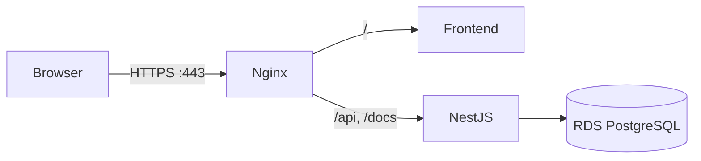

# Plan It API

NestJS backend for Plan It — JWT auth, tasks, goals, habits, web-push reminders, and user profiles (including avatars).  
**Live API behind [my-planit.duckdns.org](https://my-planit.duckdns.org), hosted on AWS (EC2 + RDS).**

## Live demo

| | |
| --- | --- |
| App | [https://my-planit.duckdns.org](https://my-planit.duckdns.org) |
| Swagger (`/docs`) | [https://my-planit.duckdns.org/docs](https://my-planit.duckdns.org/docs) |
| API base | `https://my-planit.duckdns.org/api` |
| Health | `GET /api/health` → `{ "ok": true }` |

Production runs on a single AWS `t3.micro` **EC2** instance with **RDS** (PostgreSQL), **Nginx**, and **HTTPS** (Let’s Encrypt on DuckDNS).  
Nginx proxies `/api` and `/docs` to this NestJS app; the frontend is served from the same host.

### Screenshots

Login page (Plan It):


Swagger UI (`Plan It API`, server `https://my-planit.duckdns.org/api`):


API groups in Swagger (tasks, goals, habits, push, …):


## Tech stack

- **NestJS** + TypeScript — HTTP API
- **Prisma** + **PostgreSQL** — data layer (local Docker / AWS RDS)
- **JWT** (access + refresh) — auth
- **Web Push** (`web-push` + VAPID) — scheduled task reminders
- **Swagger** (`/docs`) — interactive API docs
- **Nginx** — reverse proxy, TLS termination, `/api` routing
- **AWS EC2** (`t3.micro`) + **RDS** — hosting

## Architecture

```text
                    HTTPS (443)
                         │
                         ▼
              ┌─────────────────────┐
              │   Nginx on EC2      │
              │   (TLS + routing)   │
              └─────────┬───────────┘
                        │
          ┌─────────────┼─────────────┐
          ▼             ▼             ▼
     Frontend        NestJS        /docs
     (static)      (/api → :3001)  (proxied)
                        │
                        ▼
                 Amazon RDS
                 (PostgreSQL)
```



## Deployment on AWS

Plan It API is part of the same AWS portfolio stack as the frontend:

- **EC2 (`t3.micro`)** — NestJS runs on the VM (SSH deploy); no container platform required for this size.
- **RDS (PostgreSQL)** — managed DB separate from the app process; survives EC2 restarts.
- **Nginx** — TLS termination on `my-planit.duckdns.org`, serves the frontend, proxies `/api` + `/docs` to NestJS (one browser origin).
- **HTTPS (Let’s Encrypt)** — keeps auth tokens off plain HTTP and enables browser **Web Push**.
- **VAPID env** — `VAPID_PUBLIC_KEY` / `VAPID_PRIVATE_KEY` / `VAPID_SUBJECT` configured on the server for reminder delivery.

This is a learning / portfolio deploy, not a multi-AZ or auto-scaling setup.

## Run locally

1. Start Postgres:

```bash
docker compose up -d
```

2. Copy env and install:

```bash
copy .env.example .env
npm install
npx prisma generate
npx prisma migrate dev
npm run start:dev
```

Local API: http://localhost:3001  
Local docs: http://localhost:3001/docs

Set `PUBLIC_URL` in `.env` to the public API base (locally `http://localhost:3001`; on AWS typically `https://my-planit.duckdns.org/api`) so avatar URLs and Swagger’s server match the environment.

For web push, also set `VAPID_PUBLIC_KEY`, `VAPID_PRIVATE_KEY`, and `VAPID_SUBJECT` (see `.env.example`).

## API surface

### Auth & users

- Auth: login / register / refresh
- Users: current user profile + avatar upload

### Planning

- `GET/POST/PATCH/DELETE /projects`
- `GET/POST/PATCH/DELETE /tags`
- Extended `GET/POST/PATCH/DELETE /tasks` with priority, notes, start/end time, project, tags, reminder (`reminderAt`), recurrence, and subtasks (`parentId`)
- Task list by date range (for calendar / home views)
- `GET/POST/PATCH/DELETE /goals`
- `GET/POST/PATCH/DELETE /habits` + daily check-in

### Push reminders

- Subscribe / unsubscribe browser push endpoints
- Scheduled delivery for due `reminderAt` values
