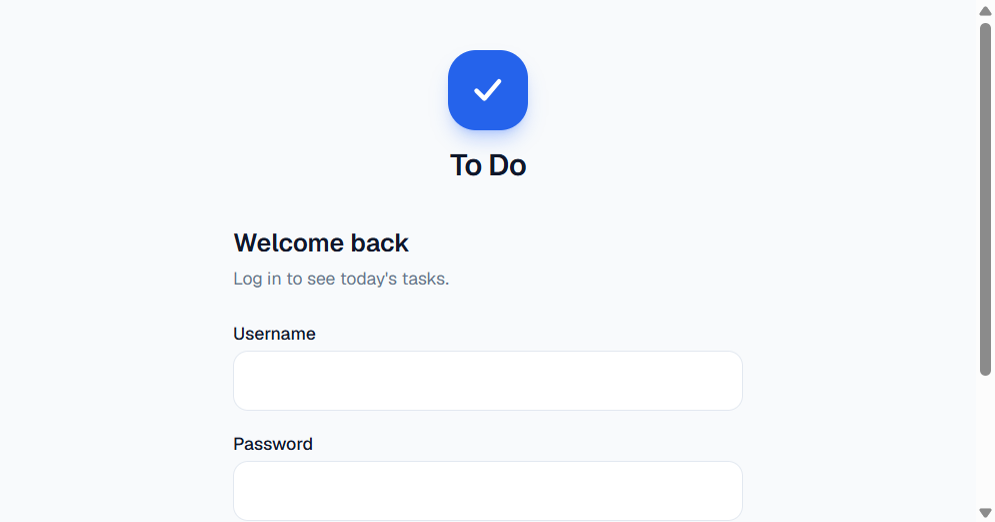
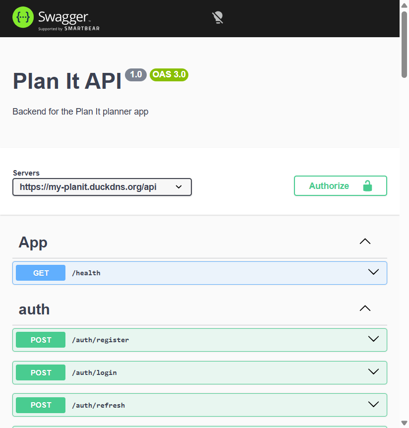
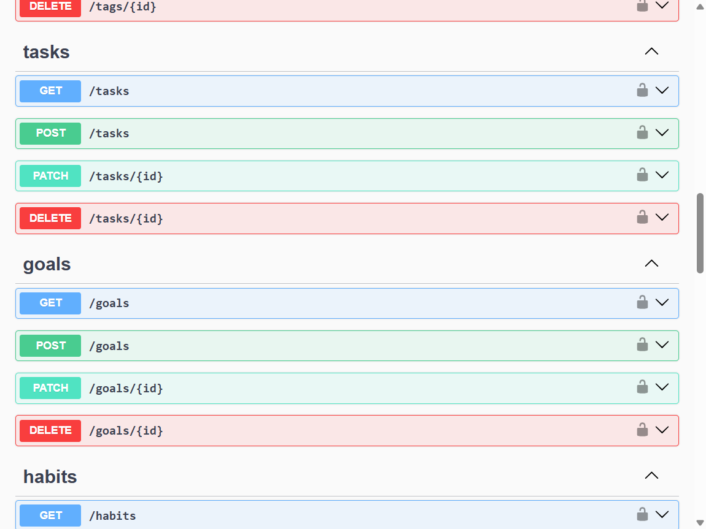
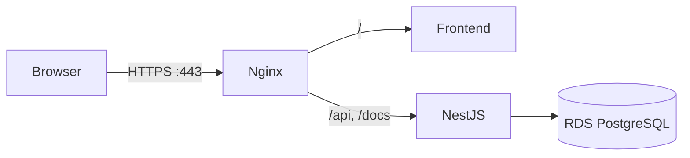

# Plan It API

NestJS backend for Plan It — JWT auth, tasks, goals, habits, reminders, and user profiles (including avatars).  
**Hosted on AWS (EC2 + RDS).**

## Live demo

| | |
| --- | --- |
| App | [https://my-todo.duckdns.org](https://my-todo.duckdns.org) |
| Swagger (`/docs`) | [https://my-todo.duckdns.org/docs](https://my-todo.duckdns.org/docs) |
| API base | `https://my-todo.duckdns.org/api` |
| Health | `GET /api/health` → `{ "ok": true }` |

Deployed on AWS with **EC2**, **RDS**, **Nginx**, and **HTTPS** (single `t3.micro` instance).

### Screenshots

Login page:



Swagger UI (server set to `/api`):



API endpoints in Swagger:



## Tech stack

- **NestJS** + TypeScript — HTTP API
- **Prisma** + **PostgreSQL** — data layer (local Docker / AWS RDS)
- **JWT** (access + refresh) — auth
- **Swagger** (`/docs`) — interactive API docs
- **Nginx** — reverse proxy, TLS termination, `/api` routing
- **AWS EC2** (`t3.micro`) + **RDS** — hosting

## Architecture

```text
                    HTTPS (443)
                         │
                         ▼
              ┌─────────────────────┐
              │   Nginx on EC2      │
              │   (TLS + routing)   │
              └─────────┬───────────┘
                        │
          ┌─────────────┼─────────────┐
          ▼             ▼             ▼
     Frontend        NestJS        /docs
     (static)      (/api → :3001)  (proxied)
                        │
                        ▼
                 Amazon RDS
                 (PostgreSQL)
```



## Deployment choices

- **EC2** — one small VM is enough for this app; simple SSH deploy and full control without a container platform.
- **Nginx** — terminates TLS, serves the frontend, and proxies `/api` (and `/docs`) to NestJS so the browser talks to one origin.
- **HTTPS** — Let’s Encrypt on the DuckDNS hostname; keeps login and tokens off plain HTTP.
- **RDS** — managed Postgres separate from the app process; survives EC2 restarts and keeps DB credentials out of the app image/disk habit.

This is a learning / portfolio deploy on a single `t3.micro`, not a multi-AZ or auto-scaling setup.

## Run locally

1. Start Postgres:

```bash
docker compose up -d
```

2. Copy env and install:

```bash
copy .env.example .env
npm install
npx prisma generate
npx prisma migrate dev
npm run start:dev
```

Local API: http://localhost:3001  
Local docs: http://localhost:3001/docs

Set `PUBLIC_URL` in `.env` to the public API base (locally `http://localhost:3001`; on AWS typically `https://my-todo.duckdns.org/api`) so avatar URLs and Swagger’s server match the environment.

## Phase 1 planning APIs

- `GET/POST/PATCH/DELETE /projects`
- `GET/POST/PATCH/DELETE /tags`
- Extended `GET/POST/PATCH/DELETE /tasks` with priority, notes, start/end time, project, tags, reminder, recurrence, and subtasks (`parentId`)

